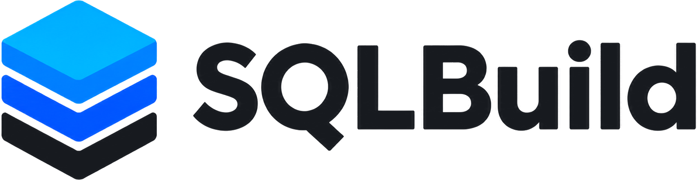

<p align="center">
  <picture>
    <source media="(prefers-color-scheme: dark)" srcset="https://raw.githubusercontent.com/sqlstack-io/sqlbuild/main/website/public/assets/logo-dark.png">
    
  </picture>
</p>

<p align="center">
  <strong>The refactorable warehouse.</strong> Verify early, test properly, and refactor safely.
</p>

<p align="center">
  <a href="https://sqlbuild.com">Website</a> ·
  <a href="https://sqlbuild.com/docs/">Docs</a> ·
  <a href="https://sqlbuild.com/docs/quickstart/">Quickstart</a> ·
  <a href="https://sqlbuild.com/docs/roadmap/">Roadmap</a>
</p>

Change your warehouse as often as your code. SQLBuild brings compile-time checks, end-to-end tests
and safe renames to your SQL, so change stops being risky. It is a free, open-source framework for
SQL and Python data pipelines, and it keeps its state in append-only tables in your own warehouse:
no external state database, no manifest files and no paid tier.

Its compiler and planner run in Rust. Warehouse execution and extensions use Python.

<p align="center">
  
</p>

Move an incremental model to a new folder and name with `sqb mv`, and `sqb plan` migrates its table
instead of rebuilding it.

## Quick start

```bash
pip install sqlbuild
sqb playground waffle-shop
cd waffle-shop
sqb plan
sqb build
sqb test
```

The playground runs on local DuckDB, with no warehouse credentials.

## What it does

### Catch mistakes before anything runs

- **Compile-time checks.** SQLBuild resolves references, validates SQL, infers column types, checks
  [contracts](https://sqlbuild.com/docs/concepts/models/contracts/) and computes column lineage,
  all offline. A typo'd column fails in seconds, not halfway through a warehouse run.
- **Your conventions as rules.** Built-in and custom Python
  [rules](https://sqlbuild.com/docs/concepts/rules/) turn review comments into compile errors: for
  example, marts can't read sources directly, or every final model declares its key.

### Prove it works

- **Tests across models.** SQL [tests](https://sqlbuild.com/docs/concepts/testing/) mock the
  sources and check the result through every model in between, with macros as test helpers. Macro,
  UDF and table-function tests are built in.
- **End-to-end scenarios.** Build the real graph against fixture data, capture fixtures from the
  warehouse, and replay them locally on DuckDB in CI.
  See [scenarios](https://sqlbuild.com/docs/concepts/scenarios/).
- **Audits and diffs.** Audits run before data reaches the target table, and
  [data diffs](https://sqlbuild.com/docs/concepts/diff/) compare dev against prod or any query.

### Change it without rebuilding everything

- **Renames keep their history.** [`sqb rename` and `sqb mv`](https://sqlbuild.com/docs/cli/rename/)
  update every reference, and the next build
  [migrates](https://sqlbuild.com/docs/concepts/models/migrations/) the existing table instead of
  rebuilding it. The old name keeps working through a compatibility view.
  `sqb rename <model>.<column>` renames an incremental model's column in place.
- **Replay on change.** When a model's SQL changes, choose how far back to reprocess, from only the
  new data to the last 14 days to a full rebuild, with
  [`replay_on_change`](https://sqlbuild.com/docs/concepts/incremental/#replay-on-change).
- **Macros don't have to be global.** Keep macros, enums and constants next to the models that use
  them, and preview what a move would break with `sqb scope`. See
  [declaration scopes](https://sqlbuild.com/docs/concepts/declaration-scopes/).
- **Tidy up safely.** The [janitor](https://sqlbuild.com/docs/cli/janitor/) archives stale tables
  before anything is deleted.

### Find out what happened

- **Every run is recorded.** [Recall](https://sqlbuild.com/docs/concepts/observability/recall/)
  keeps each command's statements, SQL, audit results and exact output. Agents and people query it
  with SQL through [`sqb recall`](https://sqlbuild.com/docs/cli/recall/), then check live state in
  the warehouse with the same command. History stays in a SQLite file in the project, or in
  ClickHouse for a team.

Ingestion with Python loaders, and Python tasks, assets and checks, run in the same graph as your SQL
models. See the [docs](https://sqlbuild.com/docs/) for everything else.

## In the terminal

Each demo is real output from the example projects in [`website/examples`](website/examples),
running on local DuckDB.

### A renamed column breaks the contract

`daily_revenue` declares `contract enforced`. Renaming `waffles_sold` to `units_sold` in the
`SELECT` fails at compile time, before anything reaches the warehouse.

<p align="center">
  
</p>

Both sides are reported: the new column isn't in the contract, and the declared one is gone.

### Your own conventions as compile errors

Rules are Python functions in your project. This one, from
[`rules/layers.py`](website/examples/waffle-shop/rules/layers.py), says marts must read sources
through staging:

```python
from sqlbuild.rules import Finding, Model, RuleContext, rule


@rule(
    code="XSQBRARCH001",
    message="Marts must read sources through staging",
    remediation="Reference a staging model with __ref() instead.",
)
def marts_use_staging(*, model: Model, ctx: RuleContext) -> list[Finding]:
    layer = ctx.project.tree.relative_parts(path=model.path, under="models")[0]
    sql = ctx.sql.for_model(model).authored.source
    if layer != "marts" or "__source(" not in sql:
        return []
    line = sql[: sql.index("__source(")].count("\n") + 1
    return [ctx.finding(subject=model, line=line)]
```

A mart that reads `__source("raw__payments")` directly now fails, and so does the unit test that
has no mock for it:

<p align="center">
  
</p>

See [rules](https://sqlbuild.com/docs/concepts/rules/).

### See what a move would break

`sqb scope --as-path` previews moving a model before you move it.

<p align="center">
  
</p>

Look at `Lost` and `Invalidated usages`: the model uses an enum and a macro that are private to
`models/marts`, so moving it would break both.

## Example

A model is a SQL file with a `MODEL()` header and a `SELECT`:

```sql
MODEL (
  description "One row per order",
  materialized table,
  columns (
    order_id (audits [not_null, unique]),
  ),
  tags [marts],
);

SELECT
  o.order_id,
  o.customer_id,
  p.amount_cents AS total_cents,
  @py.cents_to_dollars("p.amount_cents") AS total_dollars
FROM __ref("stg_orders") o
JOIN __ref("stg_payments") p USING (order_id)
```

Python macros are plain functions that return SQL, kept next to the models that use them; SQL
macros in `macros/sql/` cover logic-free fragments with typed, checked arguments:

```python
# models/marts/_sqlbuild/_macros/python/currency.py
def cents_to_dollars(column: str) -> str:
    """Convert a cents integer column to a dollars decimal with two decimal places."""
    return f"ROUND(({column}) / 100.0, 2)"
```

A test mocks the sources and asserts on the model, resolving every model in between from its real
SQL:

```sql
TEST();

WITH
__source__raw__orders AS (
  SELECT
    1 AS id,
    100 AS customer_id,
    2 AS waffle_type_id,
    3 AS quantity,
    CAST('2026-04-01 10:00:00' AS TIMESTAMP) AS ordered_at,
    'completed' AS status
),
__source__raw__payments AS (
  SELECT
    10 AS id,
    1 AS order_id,
    1500 AS amount_cents,
    'credit_card' AS payment_method,
    CAST('2026-04-01 10:05:00' AS TIMESTAMP) AS paid_at,
    'success' AS status
),
__expected__fact_orders AS (
  SELECT 1 AS order_id, 100 AS customer_id, 1500 AS total_cents, 15.00 AS total_dollars
)
```

## Warehouses

| Warehouse | Status |
|-----------|--------|
| Snowflake | Supported |
| DuckDB | Supported |
| MotherDuck | Supported |
| PostgreSQL | Supported |
| BigQuery | Beta |
| Databricks | Beta |
| SQL Server | Beta |

Snowflake is the main target. Beta adapters build, test and plan, but have had less production use
so far. See [adapters](https://sqlbuild.com/docs/concepts/adapters/).

## Free and independent

SQLBuild is Apache 2.0 and will stay free: no paid tier, no commercial edition, and no feature held
back for one. Its state lives in your warehouse, next to your data. See the
[roadmap](https://sqlbuild.com/docs/roadmap/) for what's next.

## Contributing

Contributions are welcome. See [CONTRIBUTING.md](CONTRIBUTING.md).

## License

SQLBuild is licensed under the [Apache License 2.0](LICENSE).
